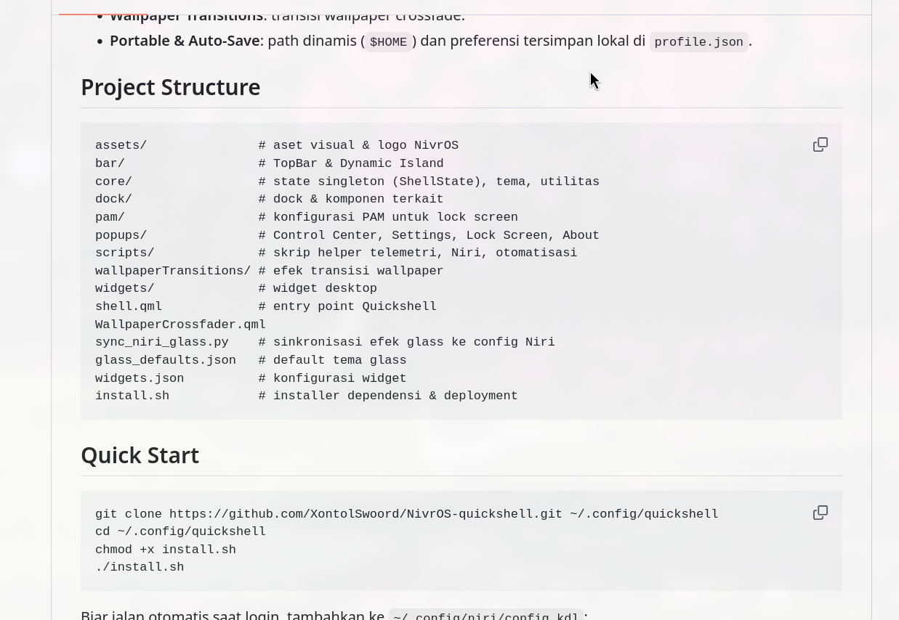

# NivrOS-quickshell

A macOS-inspired desktop shell with a Liquid Glass look, built on **Quickshell** for the **Niri** Wayland compositor.

## Highlights

- **Top Bar & Dynamic Island**: interactive notifications, media/OSD/recording/timer indicators, adaptive/compact/expanded modes.
- **Control Center, Popups & Settings**: themes (Solid / Liquid Glass, Dark / Light), notifications, audio/network, system info.
- **Dock & App Launcher**: launcher, responsive dock, lock screen.
- **Wallpaper Transitions**: crossfade wallpaper transitions.
- **Portable & Auto-Save**: dynamic paths (`$HOME`), user preferences stored locally in `profile.json`.

## Project Structure

    assets/               # visual assets & NivrOS logo
    bar/                  # TopBar & Dynamic Island
    core/                 # state singleton (ShellState), theme, utilities
    dock/                 # dock and related components
    pam/                  # PAM config for the lock screen
    popups/               # Control Center, Settings, Lock Screen, About
    scripts/              # helper scripts: telemetry, Niri, automation
    wallpaperTransitions/ # wallpaper transition effects
    widgets/              # desktop widgets
    shell.qml             # Quickshell entry point
    WallpaperCrossfader.qml
    sync_niri_glass.py    # syncs glass effects into the Niri config
    glass_defaults.json   # default glass theme
    widgets.json          # widget configuration
    install.sh            # dependency installer & deployment

## Quick Start

    git clone https://github.com/XontolSwoord/NivrOS-quickshell.git ~/.config/quickshell
    cd ~/.config/quickshell
    chmod +x install.sh
    ./install.sh

To start the shell automatically on login, add this to `~/.config/niri/config.kdl`:

    spawn-at-startup "qs"

## Credits

- **Creator & Maintainer:** XontolSwoord
- **Built with:** [Quickshell](https://quickshell.org) and [Niri](https://github.com/YaLTeR/niri)
- **Inspiration:** [iNiR](https://github.com/snowarch/iNiR) (visual reference and repo structure)

## License

Released under the [MIT License](LICENSE).
