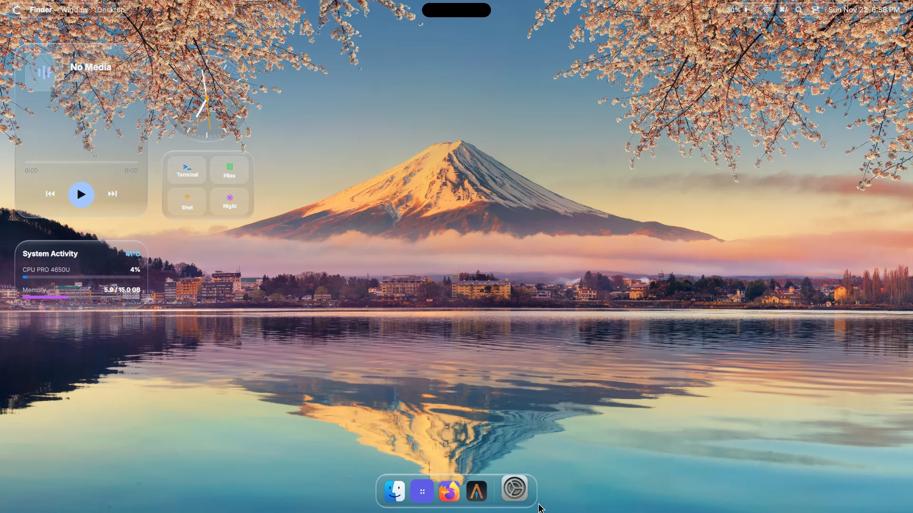
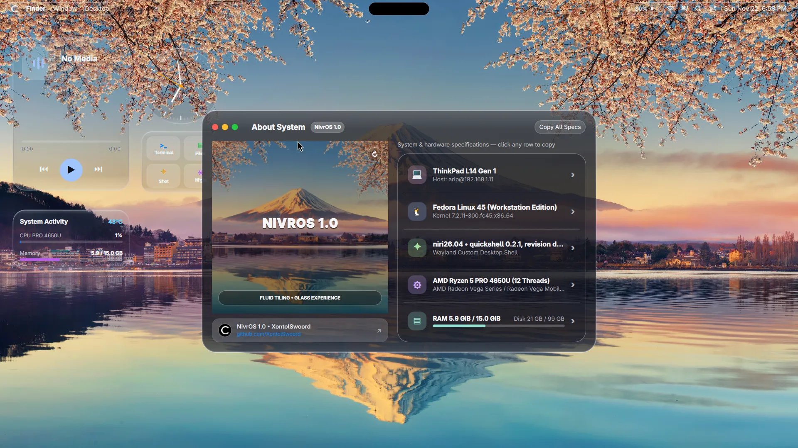
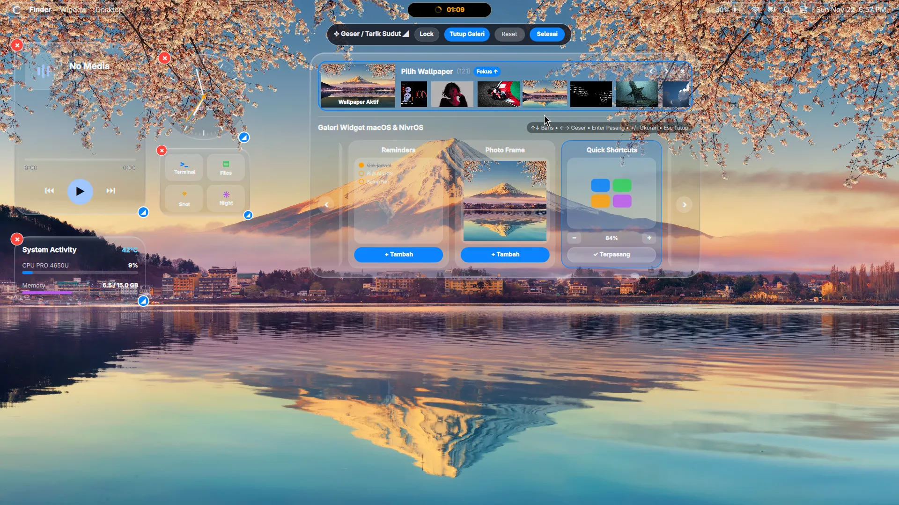
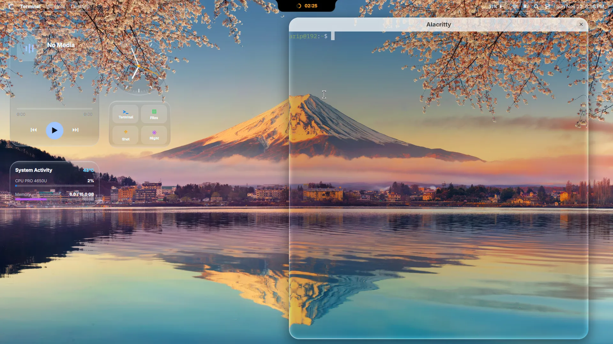
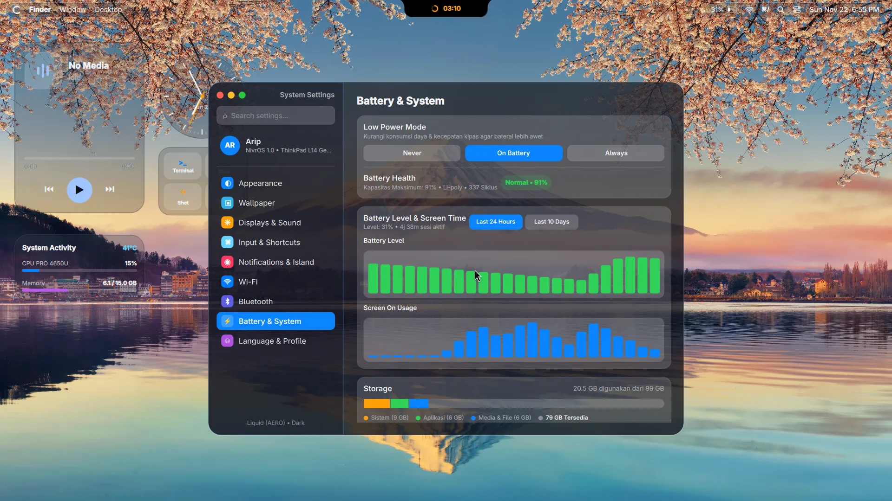
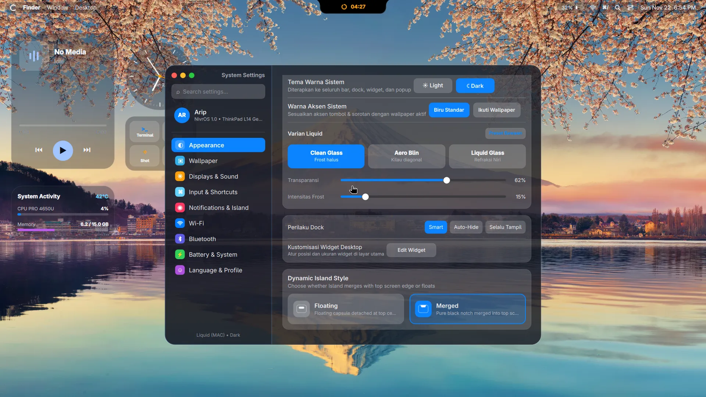
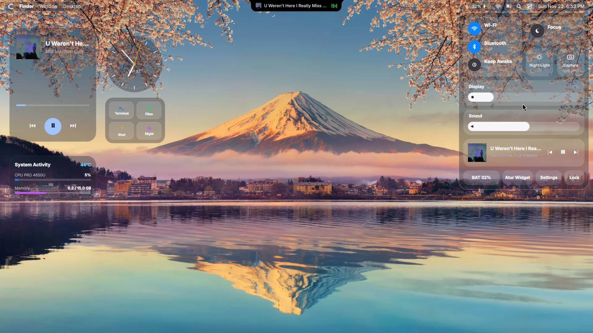
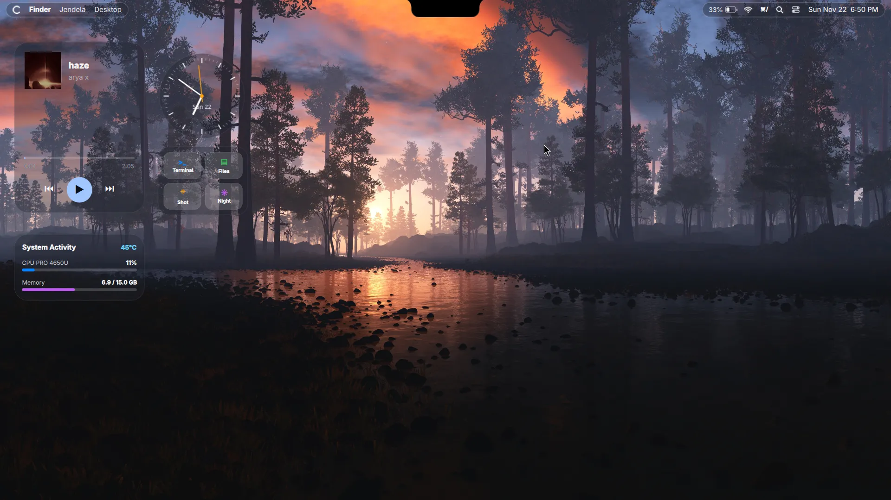

# NivrOS-quickshell

A macOS-inspired desktop shell with a Liquid Glass look, built on **Quickshell** for the **Niri** Wayland compositor.

## Highlights

- **Top Bar & Dynamic Island**: interactive notifications, media/OSD/recording/timer indicators, adaptive/compact/expanded modes.
- **Control Center, Popups & Settings**: themes (Solid / Liquid Glass, Dark / Light), notifications, audio/network, system info.
- **Dock & App Launcher**: launcher, responsive dock, lock screen.
- **Wallpaper Transitions**: crossfade wallpaper transitions.
- **Portable & Auto-Save**: dynamic paths (`$HOME`), user preferences stored locally in `profile.json`.

## Screenshots

  
  
  
  
  
  
  

## Project Structure

    assets/               # visual assets & NivrOS logo
    bar/                  # TopBar & Dynamic Island
    config/               # example Niri & Alacritty configs
    core/                 # state singleton (ShellState), theme, utilities
    dock/                 # dock and related components
    docs/                 # screenshots
    pam/                  # PAM config for the lock screen
    popups/               # Control Center, Settings, Lock Screen, About
    scripts/              # helper scripts: telemetry, Niri, automation
    wallpaperTransitions/ # wallpaper transition effects
    widgets/              # desktop widgets
    shell.qml             # Quickshell entry point
    WallpaperCrossfader.qml
    sync_niri_glass.py    # syncs glass effects into the Niri config
    glass_defaults.json   # default glass theme
    widgets.json          # widget configuration
    install.sh            # dependency installer & deployment

## Requirements

- **Niri** Wayland compositor and **Quickshell** (`qs`)
- Runtime tools: `playerctl`, `pactl` (PulseAudio/PipeWire), `wpctl` (WirePlumber), `brightnessctl`, `nmcli` (NetworkManager), `bluetoothctl` (BlueZ), `wl-clipboard`, `grim`, `slurp`, `wf-recorder`, `ffmpeg`, `jq`, `libnotify`, `power-profiles-daemon`
- Optional: `alacritty` (terminal theme sync), `qt6ct` and the **Mkos-Big-Sur** icon theme (app icons)

## Installation

Automatic (Arch, Fedora, Debian/Ubuntu):

    git clone https://github.com/XontolSwoord/NivrOS-quickshell.git ~/NivrOS-quickshell
    cd ~/NivrOS-quickshell
    chmod +x install.sh
    ./install.sh

The installer installs dependencies, backs up any existing config, and never overwrites your Niri or Alacritty config. Use `./install.sh --no-start` to skip launching the shell.

Manual: install the requirements above, copy this repo to `~/.config/quickshell`, then run `qs`.

## Niri configuration

NivrOS reads and edits `~/.config/niri/config.kdl`. Add this to start it on login:

    spawn-at-startup "qs"

And these inside the `binds { }` block:

    Mod+Slash { spawn "qs" "ipc" "call" "shell" "toggleKeybinds"; }
    Super+Alt+L { spawn "qs" "ipc" "call" "lockscreen" "lock"; }

A full example is in `config/niri/config.kdl.example`.

Default folders: `~/Pictures/Wallpapers`, `~/Pictures/Screenshots`, `~/Videos`.

## Credits

- **Creator & Maintainer:** XontolSwoord (design direction, configuration, testing on real hardware)
- **AI Collaborator:** Gemini (QML components, animations, keyboard and touchpad navigation, telemetry integration, bug fixing)
- **Built with:** [Quickshell](https://quickshell.org) and [Niri](https://github.com/YaLTeR/niri)
- **Icon theme:** [Mkos-Big-Sur](https://github.com/zayronxio/Mkos-Big-Sur) by zayronXIO (used for app icons, not bundled)
- **Inspiration:** [iNiR](https://github.com/snowarch/iNiR) (visual reference and repo structure)

## Status

- Tested on **Fedora** with Niri. Arch and Debian/Ubuntu paths in `install.sh` are best-effort and **untested**.
- Quickshell updates can break QML shells when Qt updates; if `qs` fails after a system upgrade, rebuild or update Quickshell.

## License

Released under the [MIT License](LICENSE).
